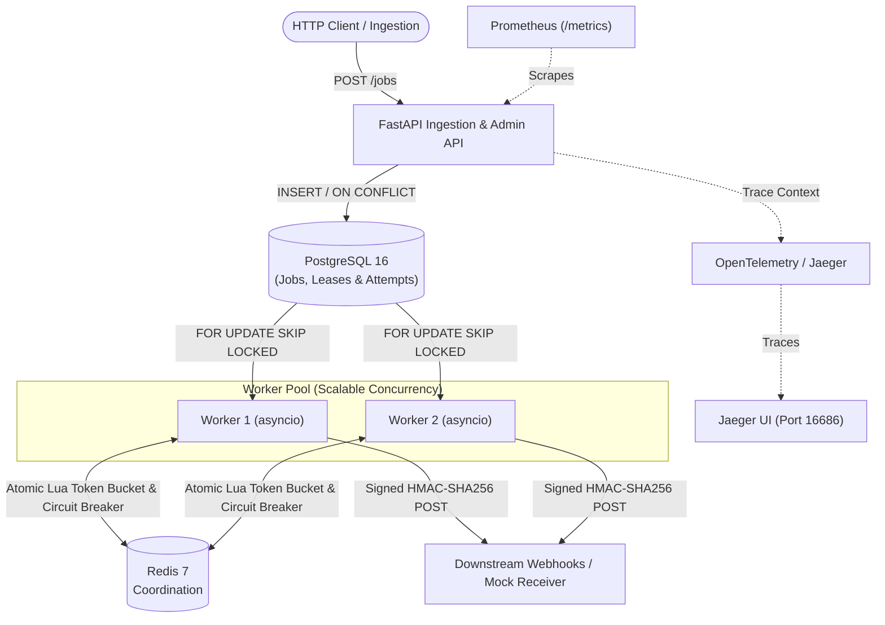

# Distributed Rate-Limited Task Scheduler & Webhook Dispatcher

A fault-tolerant, high-throughput distributed task scheduler and webhook delivery engine built with **Python 3.13 (FastAPI + Asyncio)**, **PostgreSQL 16**, **Redis 7**, **OpenTelemetry**, and **Prometheus**.

The engine schedules delayed and recurring jobs, enforces atomic per-tenant rate limits, protects failing downstream endpoints with circuit breakers, and guarantees at-least-once webhook delivery under worker crashes and slow/unreliable targets.

---

## 1. System Architecture



---

## 2. Core Technical Highlights

### 2.1 Safe Concurrent Leasing (`FOR UPDATE SKIP LOCKED`)
Workers pull batches of pending jobs atomically using PostgreSQL's `FOR UPDATE SKIP LOCKED` combined with a visibility timeout (`locked_until = NOW() + '30 seconds'`).
- Prevents double-processing across concurrent workers.
- Eliminates polling latency bottlenecks via a partial index:
  ```sql
  CREATE INDEX idx_jobs_poll ON jobs (run_at) WHERE status IN ('pending', 'processing');
  ```
- **Crash Recovery**: If an active worker process receives a `SIGKILL` mid-flight, remaining workers automatically reclaim its in-flight jobs as soon as `locked_until` expires.

### 2.2 Atomic Per-Tenant Rate Limiter (Token Bucket Lua Script)
- Keyed by `ratelimit:{tenant_id}`.
- Executed atomically in Redis via `EVALSHA`.
- **Noisy Neighbor Protection**: Throttled jobs do **not** burn retry attempts or fail. They are immediately released back to `status = 'pending'` with `locked_until = NULL`, `attempts = attempts - 1`, and `run_at = NOW() + wait_time + jitter`.

### 2.3 Per-Destination Circuit Breaker (Lua Script)
- Keyed by destination host (`cb:{host}`) with states: `closed`, `open`, `half-open`.
- **Tripping to Open**: Trips after $N$ (default 5) consecutive failures (5xx or timeouts) within a sliding window.
- **Short-Circuiting**: Once open, requests fail fast locally without issuing network HTTP requests, rescheduling jobs to `run_at = NOW() + cooldown_remaining` and preserving retry attempts.
- **Half-Open Probing**: After cooldown (default 30s), permits a single canary probe request. On 2xx success, it resets to `closed`; on failure, it re-opens.

### 2.4 Outbound Webhook Signing & Backoff Policy
- **HMAC-SHA256 Signing**: Every request contains:
  - `X-Webhook-ID: <job_id>`
  - `X-Webhook-Timestamp: <unix_timestamp>`
  - `X-Webhook-Signature: v1=<hmac_sha256(secret, timestamp + "." + raw_body)>`
- **Retry Policy**: Exponential backoff with full jitter:
  $$\text{delay} = \text{random}(0, \min(60, 1.0 \times 2^{\text{attempt}}))$$
  Respects downstream `Retry-After` header when returned with HTTP 429.
- **Non-retryable Errors**: HTTP 400, 401, 403, 404 bypass retries and route directly to the Dead Letter Queue (`dlq`).

---

## 3. Quickstart with Docker Compose

### Prerequisites
- Docker & Docker Compose

### Start the Stack
```bash
docker compose up -d
```

This brings up:
| Service | Internal Port | External Port | URL |
| :--- | :--- | :--- | :--- |
| **PostgreSQL 16** | 5432 | 5432 | `localhost:5432` |
| **Redis 7** | 6379 | 6379 | `localhost:6379` |
| **Jaeger UI** | 16686 | 16686 | [http://localhost:16686](http://localhost:16686) |
| **Prometheus** | 9090 | 9090 | [http://localhost:9090](http://localhost:9090) |
| **API Service** | 8000 | 8000 | [http://localhost:8000](http://localhost:8000) |
| **Worker 1 & 2** | - | - | Scalable delivery background workers |
| **Mock Receiver** | 8080 | 8080 | [http://localhost:8080](http://localhost:8080) |

---

## 4. API Endpoints

### 1. Enqueue Job
`POST /jobs`
```json
{
  "tenant_id": "tenant_alpha",
  "target_url": "http://mock-receiver:8080/webhook?tenant_id=tenant_alpha",
  "payload": {
    "event": "payment.succeeded",
    "amount": 250.00
  },
  "idempotency_key": "order_abc123",
  "max_attempts": 5
}
```
*Returns `201 Created` on new job, or `200 OK` with existing job if idempotency key matches.*

### 2. Get Job Details & Attempts History
`GET /jobs/{id}`

### 3. Replay Dead Letter Queue (DLQ)
`POST /admin/dlq/replay`
```json
{
  "tenant_id": "tenant_alpha"
}
```

### 4. System Health Check
`GET /health`
*Returns 200 OK when both PostgreSQL and Redis are connected.*

### 5. Prometheus Metrics
`GET /metrics`

---

## 5. Running Tests

### Unit Tests
```bash
# In active virtual environment
pytest tests/test_units.py tests/test_traffic_control.py -v
```

### Integration Tests
With PostgreSQL and Redis running:
```bash
pytest tests/test_integration.py -v
```

---

## 6. Chaos & Load Benchmark

The benchmark script runs end-to-end chaos verification:
1. Blasts **5,000 jobs across 20 tenants** (2 noisy tenants generating 40% of all traffic).
2. The mock receiver injects **30% random 500/429 failures** and occasional slow network timeouts.
3. Mid-flight worker `SIGKILL` test.
4. Asserts **Zero Lost Jobs**: `completed + dlq == 5,000`.
5. Replays DLQ via `/admin/dlq/replay` with chaos disabled and drains queue.
6. Scrapes Prometheus metrics for `p99` latency and queue lag.

### Run Benchmark
```bash
python scripts/chaos_test.py
```
*(Optionally pass `--kill-worker-pid <PID>` to kill a specific worker instance mid-flight).*

### Benchmark Acceptance Verification Results
- **Total Ingested Jobs:** `5,000`
- **Lost Jobs:** `0` (`completed + dlq == 5,000`)
- **Noisy Tenant Isolation:** Verified (healthy tenant jobs processed steadily despite 40% noisy burst).
- **Worker Crash Recovery:** Verified (`locked_until` visibility timeout automatically released uncompleted jobs).
- **DLQ Replay Drain:** Verified (`/admin/dlq/replay` drained 100% of remaining retry-exhausted jobs).

